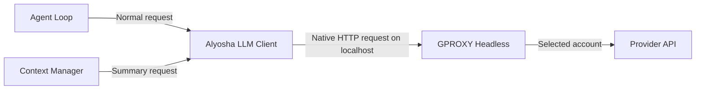

# LLM Client / Gateway

This component connects Alyosha to the model selected for the turn. The client is part of Alyosha. It encodes requests for the provider's native API and assembles a complete response or a model error. GPROXY Headless is a separate executable on localhost. It routes those requests to the selected provider and manages the account credentials. [Architecture overview](README.md) · [Native routes and credentials](#native-requests-and-credentials)

## Default instruction for normal requests

> You are Alyosha, a personal assistant.

At session start Alyosha appends memory guidance and the memory index, then skills guidance and the skills index, to this instruction. In ACP mode it also appends one line naming the chat bridge. The result stays fixed until the next compaction, which rebuilds the indexes. [Durable sessions](SessionStore.md#without-the-nightly-fresh-start) [Chat channels](Channels.md#what-alyosha-acp-does) [Memory](Memory.md#what-the-model-sees) · [Skills](Skills.md#what-the-model-sees)

## One model request



1. The Agent Loop supplies a prepared conversation, tool definitions, and the provider and model pinned for the turn. The Context Manager is also a caller when it needs a summary. A summary request uses an empty tool list. [Agent Loop](AgentLoop.md) · [Context Manager](ContextManager.md)
2. The client uses the selected native route through the local gateway. It preserves the order of message parts and any provider fields needed to associate a later tool result with the original assistant call.
3. The client waits for the response to finish. A complete reply can contain text, tool calls, or both. For a normal request, the loop records the reply, preserves the order and IDs of its calls, and sends each call to the Tool Executor. For a summary request, the Context Manager checks the returned text before proposing a checkpoint. [Tool Executor](ToolExecutor.md) · [Context Manager](ContextManager.md)
4. Stop cancels the active request. A broken stream or an output limit produces an incomplete-response error and the client discards the partial reply. An explicit context-window error lets the loop decide whether to request compaction.

## Provider accounts and gateway lifetime

Alyosha defaults to ChatGPT sign-in with `gpt-6.2-sol`. To use an OpenAI API key, select that provider account in your configuration before starting a session. You can change the model independently by editing its exact ID. Ordinary replies use the provider’s default output allowance. A model request fails with a timeout if it cannot connect to GPROXY within 10 seconds, or if no part of the reply arrives for 5 minutes. A reply that keeps arriving is never cut off.

V1 targets native APIs for Claude, GPT, Gemini, and DeepSeek. GPT with an OpenAI API key uses GPROXY’s `openai` channel. ChatGPT sign-in uses its `codex` channel. These names identify runtime connections. A contributor can implement and test the client with local HTTP fixtures using any development tool. GPROXY handles token refresh and can try another key in the selected provider's pool on a rate limit. A depleted pool returns a rate-limit error to Alyosha.

Alyosha's flake packages GPROXY Headless at a pinned upstream release, and you install that package next to Alyosha. GPROXY runs as its own always-on service on a fixed loopback port, and every Alyosha process connects to it: the `alyosha acp` processes behind the Telegram and QQ bridges can run at the same time. Alyosha never starts or stops it. A one-time `alyosha gateway init` command creates the master key and admin keys in a private file that the service reads at startup. Then `alyosha gateway login`, run in a terminal, creates the provider and signs in: it prints the ChatGPT sign-in address and code, which you can open on any device, or asks for an API key. Running it again is how you sign in after a login expires. Sessions never sign in themselves. When the provider is not signed in, a turn fails with a message telling you to run `alyosha gateway login`, in the chat. Signing in from the chat itself is deferred. Settings and encrypted provider credentials persist across restarts. Conversation history is saved in the session store. [Durable sessions](SessionStore.md) To upgrade the gateway, stop the service, bump the pinned release, and rebuild. [Chat channels](Channels.md) · [Installation and updates](#install-and-update-gproxy-with-nix) · [Implementation](#implementation)

## Implementation

The Rust client owns Alyosha's provider adapters, local HTTP requests, stream assembly, and the `gateway init` and `gateway login` commands, which set up GPROXY and the provider through its admin API. GPROXY runs as its own service. GPROXY owns upstream routing, credentials, and key-pool retries. The Agent Loop and Context Manager share the same client operation. [Architecture overview](README.md)

### V1 caller contract

`generate(request, cancel) -> Result<ModelReply, ModelError>` is one async operation for both normal generation and compaction.

| Crossing the client boundary | Contract |
| --- | --- |
| Normal request from the Agent Loop | GPROXY provider name, model ID, [normal system instruction](#default-instruction-for-normal-requests), optional summary, ordered history selected by the Context Manager, and registry tool definitions. Use the route’s default output allowance. |
| Summary request from the Context Manager | Same operation, pinned provider and model, summary instructions and transcript, summary reply limit, and an empty tool list. |
| Complete reply to the caller | An assistant entry with text and tool calls in their original order, plus token usage and upstream request ID when supplied. Preserve tool names, arguments, call IDs, and native replay fields. If a native API omits a call ID, assign an Alyosha ID and retain the mapping needed to send its result back. |
| Model error to the caller | Distinguish cancellation, timeout, disconnection or incomplete output, explicit context overflow, unsupported requests, not signed in (a missing provider, an expired login, or an invalid key, each with the `gateway login` hint), and rate limit. Include the retry delay when supplied. |

Use the active work’s cancellation token. Allow 10 seconds to connect to GPROXY. Once connected, fail with a timeout error after 5 minutes without receiving any response bytes. A reply that keeps streaming is never cut off, however long it takes. Both limits apply to summary requests too, and a timeout ends the turn as `Failed` through the normal error path. [State transitions](AgentState.md#state-transitions) For ordinary requests, omit the output limit on routes where it is optional. If a native API requires a value, send the route’s documented default or its supported maximum if it specifies only a maximum. Check the route’s input and output limits and tool support. The Context Manager owns the input estimate and reply reservation. [Request budgets](ContextManager.md#v1-token-budgets)

Buffer stream events and assemble tool arguments until the provider signals successful completion of the whole response. A parsed call can still be followed by a stream failure. A broken stream or output truncation must return an error and discard the buffered reply. Stop cancels the active HTTP request. For a complete normal reply the Agent Loop appends the entry and sends calls to the Tool Executor, which validates their arguments and invokes the registered handlers. For a summary the Context Manager validates the reply and creates the candidate checkpoint. [Agent Loop contract](AgentLoop.md#implementation) · [Tool Executor](ToolExecutor.md) · [Context Manager contract](ContextManager.md#implementation)

Every route streams: the Responses route for both channels, Claude's Messages API, Chat Completions, and Gemini's `streamGenerateContent?alt=sse`. One SSE reader serves all four, and each route's assembler returns the reply only after its completion event. Claude's Messages API requires `max_tokens` and publishes no default, so ordinary requests send 32,000. The `codex` channel's backend accepts no output limit, so summary requests omit it there. Provider fields for replay are kept as `Replay` parts of the assistant entry, in order, and sent again only on their own route.

### Native requests and credentials

Use the provider and model pinned by the caller for the whole turn or manual command. Prefix the native path with the configured provider’s name. A Claude provider named `work-claude`, for example, receives requests at `/work-claude/v1/messages` on the local gateway. [GPROXY mounts](https://gproxy.leenhawk.com/reference/routing-table#mounts)

| User choice | GPROXY channel | Native request path |
| --- | --- | --- |
| Claude API key | `claudeapi` | `/v1/messages` |
| GPT API key | `openai` | `/v1/responses` |
| GPT with ChatGPT sign-in (default) | `codex` | `/v1/responses` (streaming) |
| Gemini API key | `aistudio` | `/v1beta/models/{model}:generateContent` or `:streamGenerateContent?alt=sse` |
| DeepSeek API key | `deepseek` | `/v1/chat/completions` |

Match the inbound and upstream protocols and leave rewrite rules empty. GPROXY can still expand a Claude text string into an equivalent text block. Let GPROXY retry within the selected provider’s key pool and attempt limit. For the `codex` channel, Alyosha calls the local GPROXY HTTP endpoint. GPROXY authenticates to the Codex backend with the ChatGPT account configured for Alyosha. OpenAI’s public third-party ChatGPT plan flow uses a separate endpoint. [GPROXY channels](https://gproxy.leenhawk.com/guides/providers) · [OpenAI plan inference](https://developers.openai.com/siwc/token-sharing-open-source/models-and-inference)

Send the selected history entries in order. When supplied, encode the summary before those entries as conversation context with system instructions kept separate. Keep provider-specific fields with the assistant entry in memory and replay them in place on the originating route for entries included in the request. For OpenAI Responses, set `store: false` and return the model’s reasoning items with the tool results. When `[model] effort` is set, send it as `reasoning: {"effort": ...}`; without it, send no `reasoning` field, so the provider's default applies. Other APIs' thinking settings are deferred. Gemini tool calls can carry a thought signature. DeepSeek thinking mode with tools requires `reasoning_content` on later requests. [OpenAI reasoning items](https://developers.openai.com/api/docs/guides/reasoning) · [Gemini thought signatures](https://docs.cloud.google.com/gemini-enterprise-agent-platform/models/thinking/thought-signatures) · [DeepSeek thinking mode](https://api-docs.deepseek.com/guides/thinking_mode/)

### Run GPROXY as a service

GPROXY runs as one always-on systemd service, and every Alyosha process connects to it: `alyosha acp`, which the Telegram and QQ bridges run. Alyosha never starts or stops it. It runs in the container as the user `gproxy`, so only it and root hold the master key and the provider sign-in. During v1 on the host, the same service runs there instead. Never run both. [Container module](Deployment.md#host-module) · [Chat channels](Channels.md)

1. **Create its secrets once.** `alyosha gateway init`, run as root in the container by the host command, writes the secret `gproxy.env`: `/var/lib/alyosha-secrets/gproxy.env`, owned by root, mode `0400`. [Secrets](reference/Configuration.md#secrets) The file holds a fresh 32-byte master key as 64 hex characters in `GPROXY_MASTER_KEY`, plus `GPROXY_ADMIN_PASSWORD` and `GPROXY_BOOTSTRAP_ADMIN_API_KEY`, which GPROXY uses when it creates a fresh database. Passing them through the environment keeps them out of startup logs. The command refuses to run if the file already exists, because a new master key cannot open an existing database. [Upstream configuration](https://gproxy.leenhawk.com/reference/configuration)
2. **Declare the service.** systemd reads the file as root and passes it to GPROXY as its environment. GPROXY listens on a fixed loopback port and keeps its data in its own state folder. The service is skipped until the file exists.

   ```nix
   systemd.services.gproxy = let
     envFile = "/var/lib/alyosha-secrets/gproxy.env";
   in {
     wantedBy = [ "multi-user.target" ];
     wants = [ "network-online.target" ];
     after = [ "network-online.target" ];
     unitConfig.ConditionPathExists = envFile;
     serviceConfig = {
       User = "gproxy";
       StateDirectory = "gproxy";
       StateDirectoryMode = "0700";
       EnvironmentFile = envFile;
       WorkingDirectory = "/var/lib/gproxy";
       ExecStart = "${gproxy}/bin/gproxy serve --host 127.0.0.1 --port 18787 --data-dir /var/lib/gproxy"
         + " --log-format json --log-filter info --update-automatic=false";
       Restart = "on-failure";
       RestartSec = 5;
     };
   };
   ```

3. **Point Alyosha at it.** Set the address in the settings, using the same port:

   ```toml
   [gateway]
   url = "http://127.0.0.1:18787"
   ```

   Alyosha connects there for every request. If nothing answers, the request fails with a model error that names the address and suggests `systemctl status gproxy`. If GPROXY restarts during a reply, the broken stream is an incomplete-response error like any other.
4. **Sign in with `alyosha gateway login`.** This is the only way the provider gets set up or signed in again. Sessions never do it, so two Alyosha processes can never race to create the same provider. Run it in a terminal on the host: the host command runs it as root in the container, since it reads the admin key and writes a secret. [The host command](Deployment.md#the-host-command)

   1. Load the settings and `gproxy.env`. If `gproxy.env` is missing, stop and say to run `alyosha gateway init` and start the service first. Use `GPROXY_BOOTSTRAP_ADMIN_API_KEY` from it for the admin API.
   2. If the secret `gateway-key` is not set, create a gateway key with management access disabled and write it as `gateway-key`, owned by root and readable by the `alyosha` group. `POST /admin/api/api-keys` needs a `userId`: the command finds the admin user (`GPROXY_ADMIN_USER`, default `admin`) in `GET /admin/api/users`. GPROXY's documentation describes 4.3.0; check these admin calls against 4.2.5 at step 2. Alyosha never writes the settings. [Configuration](reference/Configuration.md#rules) · [Gateway keys](https://gproxy.leenhawk.com/guides/users-and-keys)
   3. If no provider has the name in `[model] provider`, create it with the channel that `[model] api` names, through `POST /admin/api/providers`. Disable upstream and downstream body capture. GPROXY sets body capture globally, not per provider, so this is `PATCH /admin/api/settings` with `logging.enableUpstreamLogBody` and `logging.enableDownstreamLogBody` false. [Body capture](https://gproxy.leenhawk.com/guides/observability#recording-bodies)
   4. Get the credential. For `codex`, POST to `/admin/api/credential-login/device/start`, print the verification address and code, and poll `device/poll` with the login session ID until you finish or the code expires. You can open the address on any device. For an API-key channel, read the key from the terminal without echo and add it through `POST /admin/api/credentials`. Replace any credential the provider already has, so running the command again is how you sign in again after a login expires or a key is revoked. [Provider login](https://gproxy.leenhawk.com/guides/providers#logging-in-to-obtain-a-credential)
   5. Send one small request through the gateway with the gateway key and report success, or the error.

   Changing only `[model] name` needs nothing. After changing `[model] provider` to a new name, run the command again. One key per provider for now. Adding several keys to the provider's pool is deferred.

   Every other Alyosha process reads only the secret `gateway-key` and sends it as `Authorization: Bearer <gateway-key>`. Only the `gateway` commands use the admin key. When a request fails because the provider does not exist, its login has expired, or its key is invalid, the client returns a not-signed-in error whose message says: "The model provider is not signed in. Run `alyosha gateway login` in a terminal." A chat shows it as **Failed:**, so a scheduled task that fails at night is how you find out. Check at step 2 which response GPROXY gives for a provider that does not exist, and record it here. Until checked, the client treats HTTP 401, 403, and 404 as not signed in.

Other users on the same machine can reach a loopback port, so every request needs the gateway key, and management needs the admin key. Command units cannot reach the container's loopback at all. [Shell sandbox](reference/ToolPermissions.md#shell-sandbox)

If `gproxy.env` is lost while the database remains, GPROXY cannot decrypt the stored credentials. Restore the file from a backup. Running `alyosha gateway init` again requires moving the old data folder away first, after which you set up the provider again.

### Install and update GPROXY with Nix

GPROXY is a Nix package in Alyosha's flake, next to `alyosha`. It fetches the official headless ZIP for one pinned release and installs the executable from inside it, unchanged. That build is a static musl binary, so it runs on NixOS without patching. These values apply to v4.2.5 on x86-64. [Headless ZIP](https://github.com/LeenHawk/gproxy/releases/download/v4.2.5/gproxy-headless-linux-x86_64-musl.zip) · [Release manifest](https://github.com/LeenHawk/gproxy/releases/download/v4.2.5/manifest.json) · [Upstream releases](https://github.com/LeenHawk/gproxy/releases)

```nix
{ stdenvNoCC, fetchurl, unzip }:
stdenvNoCC.mkDerivation rec {
  pname = "gproxy";
  version = "4.2.5";
  src = fetchurl {
    url = "https://github.com/LeenHawk/gproxy/releases/download/v${version}/gproxy-headless-linux-x86_64-musl.zip";
    hash = "sha256-...";  # the ZIP's SHA-256 from this release's manifest.json, in SRI form
  };
  nativeBuildInputs = [ unzip ];
  sourceRoot = ".";
  dontConfigure = true;
  dontBuild = true;
  dontFixup = true;  # keep the upstream executable byte for byte
  installPhase = "install -Dm755 gproxy $out/bin/gproxy";
  meta.platforms = [ "x86_64-linux" ];
}
```

Use `fetchurl` on the ZIP rather than `fetchzip`. The store hash then covers the same file as the release manifest, so you can check one against the other. Convert the manifest's hex digest with `nix hash convert --hash-algo sha256 --to sri <hex>`.

Install the package on the host alongside Alyosha. The container later installs the same package the same way. [Container module](Deployment.md#host-module)

```nix
environment.systemPackages = [
  inputs.alyosha.packages.${pkgs.system}.alyosha
  inputs.alyosha.packages.${pkgs.system}.gproxy
];
```

The service runs `gproxy` from this package. To try another build, such as a test binary, run it by hand on another port and point `[gateway] url` at it.

GPROXY's own updater is not used. The store is read-only, and the service passes `--update-automatic=false`. Watch the upstream releases page for new versions. To upgrade:

1. Let running turns finish, then stop the service with `systemctl stop gproxy`.
2. Back up the gateway's data directory, `gproxy.env`, and `config.toml`. A new release may migrate the database.
3. Change `version` and `hash` in the package, taking the hash from the new release's `manifest.json`.
4. Run `nix build .#gproxy` and check that `./result/bin/gproxy --version` reports the new release.
5. Rebuild the configuration that runs the service. It starts again with the same data and `gproxy.env`.

To roll back, switch to the previous system generation. If the new release migrated the database, also restore the data directory and configuration from step 2.

### Verify with the upstream binary and mock providers

For offline client checks, point the client at a local HTTP fixture that records requests and serves scripted provider responses. For gateway integration, run the installed GPROXY Headless binary against local mock upstreams with test credentials. Both sets of checks can run without a live account.

- On each native route, return two tool calls, send both results back, and return a final reply. Check the path, call IDs, block order, and provider-specific fields on the second request. Use a streaming fixture for the `codex` route.
- Cut a stream after the first complete tool call and before the response ends. Repeat with Stop and an output-token limit. Expect zero tool executions and zero partial assistant entries from that response.
- Have the first key return HTTP 429 and the second succeed. Exhaust the pool and check that the rate limit reaches the caller. An expired ChatGPT login that cannot refresh, an invalid key, and a missing provider each return the not-signed-in error with the `gateway login` hint.
- Run `alyosha gateway init` twice. Check that the second run refuses and the first wrote `gproxy.env` owned by root with mode `0400` and all three variables.
- Run `alyosha gateway login` without `gproxy.env`. Check that it says to run `init` first. Run it against the mock gateway for a `codex` provider and for an API-key provider. Check that it creates the provider and the `gateway-key` secret once, prints the device address and code, reads the key without echo, and that a second run replaces the credential without creating a second provider or gateway key.
- Start `alyosha acp` with no provider. Check that it does not call the admin API and that the first turn fails with the not-signed-in message.
- Start the service, then run two `alyosha acp` processes at once. Check that both get replies through the one service.
- Have the mock accept a connection and send nothing. Check for a timeout error after the idle limit, shortened in the test. Have it stream one event every minute for ten minutes. Check that the reply completes. Point the client at an address that drops packets. Check for a connect timeout.
- Stop the service and send a request. Check for a model error naming the address. Restart the service during a streamed reply and check for an incomplete-response error, then a working next request.
- Restart the service with the existing database and the same `gproxy.env`. Check that the provider and credentials remain and nothing is recreated.
- Build the package and check that `gproxy --version` reports the pinned release. After an upstream upgrade, restart with the saved data and `gproxy.env` and repeat the native tool exchange.

A live account check exercises a different boundary. Complete setup for the selected provider, send a request through GPROXY, and verify that Alyosha receives a complete reply from the configured model. Record which provider and model were exercised so the result can be distinguished from fixture coverage.
