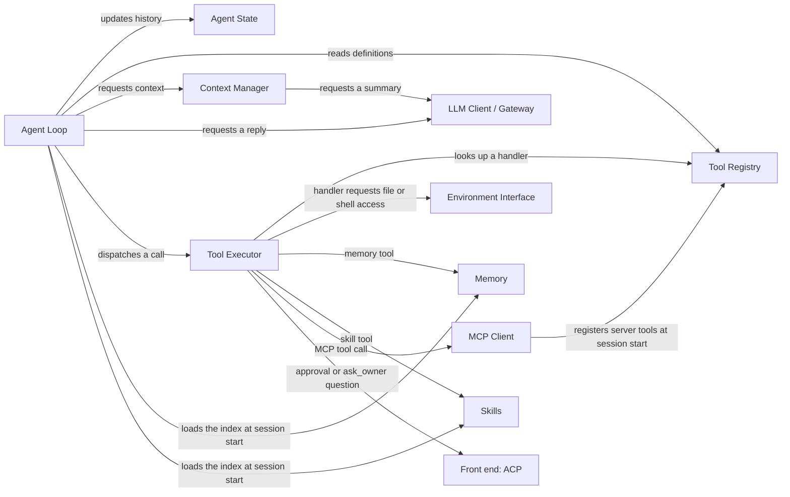

# Alyosha architecture

Alyosha is designed as a general-purpose Rust agent for NixOS. You message it through Telegram or QQ. The model can reply directly or ask to use a tool, inspect the result, and continue. The Rust code for every build step below is written and passes its offline checks under `cargo test`, including step 10's checks against a throwaway PostgreSQL server. The deployment decided on 2026-11-27 runs on ms02 since that day: fixed folders, secrets as files, journald logs, command units, and the container module with the host's `alyosha` command, whose `alyosha check` passes. The code that moves memory and people's notes into the database is written and passes its checks against a throwaway PostgreSQL server: the stores with version checks, and a one-time import of the files under `/var/lib/alyosha/memory` that is checked against them. On ms02 the move ran on 2026-11-27: the import copied 1 memory and no people's notes, matching `alyosha memory list`, and the old folder is gone. Asked what it remembers about you, it answered from that memory in your private chat and knew nothing of it in an untrusted group. [Import the old files](Memory.md#import-the-old-files) · [Move memory into the database](Deployment.md#move-memory-into-the-database) Photos, voice, video, and files are written too and pass their scripted checks. [Photos, voice, video, and files](Media.md)

## What v1 must do

V1 is done when these eight tasks work end to end, in the NixOS container, with the GPROXY service and the configuration file as designed:

1. From Telegram, "What came in my inbox today?" returns a short summary.
2. "Reply to Anna that Friday at 7 works" shows Approve and Decline buttons in Telegram, and the email goes out only after Approve.
3. "Find the opening hours of the town hall and remind me tomorrow at 9 to go" searches, reads the page in the browser, schedules a task, and the reminder arrives at 9:00.
4. A daily task, "every morning at 8, summarize my inbox and today's meetings," runs on its own for a week.
5. From Telegram, "Run the tests and fix the failing one" in a project Alyosha cloned into `/var/lib/alyosha/work/owner` reads and edits files and runs commands in command units.
6. From Telegram, "List every decision in my meeting notes" finds the notes in `/var/lib/alyosha/work/owner` with `run_command`, then reads and filters them with one `execute_code` script. Code Mode can only read files, not list folders. [Read-only Code Mode](ToolExecutor.md#read-only-code-mode)
7. From QQ, a question gets an answer, and "remind me in ten minutes to stretch" delivers the reminder in QQ, or holds it until the next message if QQ refuses to send first.
8. After `systemctl restart alyosha-telegram`, "what did I ask you before?" is answered from the earlier conversation.

## Where to start implementing

Build in this order. Each step builds only on finished ones and ends with a check.

| Step | Build | Done when |
| --- | --- | --- |
| 1 | **One turn in Rust.** Initialize the Cargo workspace at the repository root. Connect the in-memory Agent State, Agent Loop, Tool Registry, and Tool Executor to a scripted model and a fake `read_file` handler. [Turn fixture](AgentLoop.md#verification-with-a-scripted-model-and-fake-tools) | The scripted turn requests two files, one missing, and the second model request carries both results under their original call IDs. The final reply appears in history once. |
| 2 | **Gateway and configuration.** The `alyosha-config` crate, the GPROXY service on the host, `alyosha gateway init` and `gateway login`, the real client against a mock provider and then GPROXY, and the clock line. [Configuration](reference/Configuration.md#implementation) · [Gateway setup and checks](LLMClientGateway.md#implementation) | One real tool exchange with the configured model works through GPROXY. |
| 3 | **The remaining built-in tools.** Workspace files, the shell in command units, QuickJS-NG Code Mode, memory, skills, context compaction and overflow recovery, the queue, Stop, and background jobs. [Jobs](Jobs.md#implementation) · [Tool permissions](reference/ToolPermissions.md#verification) · [Executor checks](ToolExecutor.md#verification) · [Context checks](ContextManager.md#verify-the-contracts) | Their scripted checks pass under `cargo test`. Tasks 5 and 6 are checked from Telegram at step 7. |
| 4 | **MCP, approvals, and the first plugins.** The MCP Client, the approval step, and `ask_owner`. Then web search, which needs no secrets, then the browser. [MCP](MCP.md#implementation) · [Approvals](Approvals.md#implementation) · [Web search](WebSearch.md#implementation) · [Browser](Browser.md#implementation) | A scripted session searches and reads a page through the two MCP servers. "Find the opening hours of the town hall" is checked from Telegram at step 7. |
| 5 | **The container.** Move everything in, including the GPROXY service. Check first that the command units and Chromium's sandbox start there. [Deployment setup](Deployment.md#implementation) | Steps 3 and 4 work again inside the container. |
| 6 | **Email and calendar.** gogcli, signed in on the host. [Email and calendar](EmailCalendar.md#implementation) | gogcli's MCP server reads the inbox and writes a draft from a scripted session. Tasks 1 and 2 are checked from Telegram at step 7. |
| 7 | **ACP mode and the Telegram bridge**, with the shared `alyosha-bridge` crate. [ACP mode](Channels.md#implementation) · [Telegram bridge](TelegramBridge.md) | Tasks 1, 2, 5, and 6 work from Telegram. |
| 8 | **Scheduled tasks.** The schedule MCP server and the runner in the bridges. [Scheduled tasks](Schedule.md#implementation) | Tasks 3 and 4 work. |
| 9 | **The QQ bridge**, reusing the shared crate and the runner. Settle QQ's open limits with a real bot first. [QQ bridge](QQBridge.md) | Task 7 works. |
| 10 | **Durable sessions.** PostgreSQL in the container, the session store, `session/load` in `alyosha acp` and the bridges. Remove the nightly fresh session. [Durable sessions](SessionStore.md#implementation) | Task 8 works. V1 is done. |

The container comes at step 5, not last, because whether the command sandbox and Chromium's sandbox work inside it is the design's biggest unknown, and because real sign-ins and tokens from step 6 on should only ever be used inside it.

## V1 decisions and open work

| Area | Current decision |
| --- | --- |
| Assistant and model | The normal instruction is “You are Alyosha, a personal assistant.” ChatGPT sign-in and `gpt-6.2-sol` are the defaults. The user changes the account or model in the settings. [Gateway design](LLMClientGateway.md) |
| Sessions | One turn runs at a time. Messages wait in arrival order. Each history entry is saved to PostgreSQL in the container as it happens, so a restart resumes the conversation; queued messages and a turn in progress are lost. A session ends only with `/new`. There is no nightly fresh start. [Agent State](AgentState.md) · [Durable sessions](SessionStore.md) |
| Tools | Eleven built-ins cover workspace reads, writes, edits, shell commands, background jobs, read-only JavaScript, memory, recall of past sessions, skills, asking the owner, and sending files to the chat. A background job runs a long command while the conversation goes on and starts a turn when it ends. [Background jobs](Jobs.md) Each shell command runs in a systemd unit of its own, as a separate user that cannot read the agent's secrets. JavaScript uses QuickJS-NG through `rquickjs`. [Built-in tools](reference/BuiltInTools.md) · [Code Mode](ToolExecutor.md#read-only-code-mode) |
| Interface | You talk to Alyosha only through chat apps; there is no terminal interface. Messaging apps connect through separate bridge programs that drive `alyosha acp` over the Agent Client Protocol, so the core has no code for any app. Telegram and QQ come first, each through a small Rust bridge of Alyosha's own that runs as a service in the container. QQ uses the official bot API, whose reply limits make it a channel for questions and answers. In groups, anyone who mentions Alyosha gets an answer from a session for that group: a full session with your tools in groups you list as trusted, and otherwise a guest session with web search but none of your tools. [Chat channels](Channels.md) · [Group chats](Channels.md#group-chats) |
| Photos, voice, video, and files | Written after v1. Bridges pass what you send over ACP. Alyosha turns it into images and text for any model: images as they are, voice through OpenAI's transcription, video as frames and a transcript, other files saved in the session's `inbox/` for its tools. Images are kept in the session database. The model sends files back with `send_file`. Guests get images and transcripts but not files. [Photos, voice, video, and files](Media.md) |
| Memory | Curated facts in one global store in the session database. The model writes them freely, each write shows in the status area, and a version check keeps two sessions from overwriting each other. People in group chats get notes each, keyed by their user ID. [Memory](Memory.md) |
| Recall | The `recall` tool searches saved sessions by the words and by meaning, with OpenAI embeddings through GPROXY computed when a search needs them, and reads around a hit. Your private chat searches itself and your trusted groups; each group searches only itself. [Recall](Recall.md) |
| Skills | Procedures you write, in the Agent Skills layout, in `~/.agents/skills` on the host. The model sees an index and loads a skill with the `skill` tool. Bundled files are read-only at `/skills`. [Skills](Skills.md) |
| MCP | Alyosha connects to the stdio MCP servers you configure and registers their tools at session start. Servers run as trusted child processes, and calls need no approval unless the configuration marks the tool `ask`. HTTP servers and OAuth are deferred. [MCP Client](MCP.md) |
| Where it runs | Everything runs in a NixOS container that keeps its own configuration, secrets, database, and working folders, sees nothing of the host but your skills, and cannot reach the host or your local network. Inside, GPROXY, the database, the agent, and the commands each run as their own user, and each command runs in a systemd unit that sees only its session's folder. On the host, the `alyosha` command shows status and logs and sets secrets. The container comes at step 5 of the build order. [Deployment](Deployment.md) |
| Scheduled tasks | The model creates timed and repeating tasks through a schedule MCP server. The Telegram and QQ bridges run them in their sessions and deliver the results. [Scheduled tasks](Schedule.md) |
| Web search | open-webSearch's MCP server searches engines such as Bing and DuckDuckGo without an account or key. The model opens results in Chromium. SearXNG is the fallback if searches get blocked. [Web search](WebSearch.md) |
| Email and calendar | gogcli's MCP server reads Gmail and Google Calendar, tidies the mailbox, writes drafts, and sends email only after you approve. Calendar changes are deferred. [Email and calendar](EmailCalendar.md) |
| Approvals | Alyosha acts freely in its own space and asks before reaching the real world. Tools marked `ask` in the configuration, such as sending email, wait for the owner's approval in the chat. For actions only the model can recognize, such as buying, it calls `ask_owner`. Unanswered requests are declined after 60 minutes. [Approvals](Approvals.md) |
| Browser | One MCP server in the container: headless Chromium through Playwright MCP. A skill gives the model the rules for websites. Alyosha never stores passwords: Chromium loads sign-ins you save yourself on the host. [Browser](Browser.md) |
| Configuration | One strict `/etc/alyosha/config.toml`, generated from `services.alyosha.settings` in your NixOS configuration, holds every setting and no secrets, and is read by every Alyosha program. Each secret is a file of its own, set with `alyosha secret set`. Each message carries a clock line in your configured timezone. Every session works in a fixed folder under the container's `/var/lib/alyosha/work`: `owner` for your private chats, and `groups/<name>` for each trusted group, named in the configuration. [Configuration](reference/Configuration.md) |

The eight tasks above define v1. The capabilities designed beyond the core are tracked in [What Alyosha still needs](todo.md).

## The ten components

Each component has one page. It starts with what the component does and why, and its **Implementation** section gives the planned Rust contracts, edge cases, and verification steps.

| Component | What it owns | Implementation |
| --- | --- | --- |
| [Agent Loop](AgentLoop.md) | Starts one turn at a time, requests a model reply, sends each requested call to the executor in order, and records the results. | [Session driver and `run_turn`](AgentLoop.md#implementation) |
| [Agent State](AgentState.md) | Holds what the session remembers. This includes conversation history, waiting messages, active work, turn outcomes, and the latest context summary. | [Session fields and transitions](AgentState.md#implementation) |
| [Tool Registry](ToolRegistry.md) | Lists the tools the model can request and associates each name with an input schema and a handler. | [Registration and lookup](ToolRegistry.md#implementation) |
| [Context Manager](ContextManager.md) | Builds the conversation for the next request from session history. Budgets space for tools and the reply, and summarizes older exchanges when needed. | [Request preparation and compaction](ContextManager.md#implementation) |
| [LLM Client / Gateway](LLMClientGateway.md) | Sends a prepared request to the selected provider and returns a complete assistant response or an error. Alyosha owns the client and uses GPROXY as the local gateway. | [Model requests and gateway setup](LLMClientGateway.md#implementation) |
| [Environment Interface](EnvironmentInterface.md) | Gives tool handlers access to the selected workspace, session logs, and sandboxed shell. Enforces permissions at the point of access. | [Tool context and host operations](EnvironmentInterface.md#implementation) |
| [Tool Executor](ToolExecutor.md) | Handles one call. Looks up the tool, checks the caller's scope and arguments, runs the handler, and returns its output or error. | [Dispatch and cancellation](ToolExecutor.md#implementation) |
| [Memory](Memory.md) | Keeps curated facts across sessions. Supplies the memory index for the system instruction and stores the `memory` tool's writes. | [Store, index, and tool](Memory.md#implementation) |
| [Skills](Skills.md) | Reads the procedures you wrote. Supplies the skills index for the system instruction, serves the `skill` tool, and exposes bundled files at `/skills`. | [Store, index, and tool](Skills.md#implementation) |
| [MCP Client](MCP.md) | Starts the configured MCP servers, registers their tools at session start, and forwards calls to them. | [Servers, registration, and calls](MCP.md#implementation) |

## Front ends and shared pieces

These sit around the ten components. The ACP mode is the one front end that drives the session driver. The others cross several components.

| Piece | What it owns | Implementation |
| --- | --- | --- |
| [ACP mode and bridges](Channels.md) | `alyosha acp`, the front end, and the Telegram and QQ bridges that drive it. | [ACP mode](Channels.md#implementation) · [Telegram bridge](TelegramBridge.md) · [QQ bridge](QQBridge.md) |
| [Durable sessions](SessionStore.md) | The PostgreSQL session store: saving history and checkpoints, resuming a session by key, and the database service. | [Durable sessions](SessionStore.md#implementation) |
| [Approvals](Approvals.md) | The approval step in the Tool Executor's dispatch, the `ask_owner` tool, and the `Approver` each front end implements. | [Approvals](Approvals.md#implementation) |
| [Configuration](reference/Configuration.md) | The one configuration file and the loader every program shares. | [Configuration](reference/Configuration.md#implementation) |
| [Scheduled tasks](Schedule.md) | The schedule MCP server and the task runner inside the bridges. | [Scheduled tasks](Schedule.md#implementation) |
| [Background jobs](Jobs.md) | Long shell commands that run outside a turn and start a turn when they end. | [Background jobs](Jobs.md#implementation) |
| [Recall](Recall.md) | Searching saved sessions by the words and by meaning, the embeddings, and the `recall` tool. | [Recall](Recall.md#implementation) |
| [Photos, voice, video, and files](Media.md) | Turning what you send into images and text, transcription, the media unit, the media table, and `send_file`. | [Media](Media.md#implementation) |
| [Deployment](Deployment.md) | The NixOS container around everything. | [Deployment](Deployment.md#implementation) |

The browser, web search, and email and calendar are configuration on top of the MCP Client: one MCP server and a skill each. [Browser](Browser.md) · [Web search](WebSearch.md) · [Email and calendar](EmailCalendar.md)

## Follow one turn

Suppose you ask, “Which operating system does Alyosha target?”

1. The **Agent Loop** starts the turn and appends your question to **Agent State**. It gets the available tool definitions from the **Tool Registry**.
2. The **Context Manager** prepares the conversation to send and budgets for those definitions. The loop passes the request to the **LLM Client / Gateway**. Suppose the model replies with a call to `read_file` for `docs/EnvironmentInterface.md`.
3. The loop records that complete assistant response and passes the call to the **Tool Executor**. The executor looks up `read_file`, checks its arguments and scope, and invokes its handler. The handler opens the file through the **Environment Interface**, which checks that the target is inside the workspace.
4. The executor returns the text. The loop records a tool result under the original call ID. On the next model request, the model sees its call and the result together. A reply of “NixOS” with no further calls ends the turn and appears once in history.

## Where Alyosha runs

The components above run together in one process tree inside a NixOS container, with Alyosha's configuration and state mounted from the host. None of them depends on the container. The browser is configuration on top of this, not a component: one MCP server and a skill. [Deployment design](Deployment.md) · [Container setup and checks](Deployment.md#implementation) · [Browser](Browser.md)

## Shared references

- To change what `read_file` accepts or returns, see the [built-in tool contracts](reference/BuiltInTools.md).
- To change which files it may open, see the [tool permission policy](reference/ToolPermissions.md).
- To add or change a setting, see the [configuration reference](reference/Configuration.md).
- To find out what happened, or to log something new, see [logging](reference/Logging.md).
