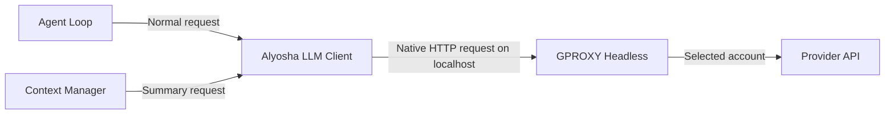

# LLM Client / Gateway

This component connects Alyosha to the model selected for the turn. The client is part of Alyosha. It encodes requests for the provider's native API and assembles a complete response or a model error. GPROXY Headless is a separate executable on localhost. It routes those requests to the selected provider and manages the account credentials. [Architecture overview](../README.md) · [Native routes and credentials](../develop/LLMClientGateway.md#native-requests-and-credentials)

## Default instruction for normal requests

> You are Alyosha, a personal assistant.

At session start Alyosha appends memory guidance and the memory index, then skills guidance and the skills index, to this instruction. In ACP mode it also appends one line naming the chat bridge. The result stays fixed until the next compaction, which rebuilds the indexes. [Durable sessions](SessionStore.md#without-the-nightly-fresh-start) [Chat channels](Channels.md#what-alyosha-acp-does) [Memory](Memory.md#what-the-model-sees) · [Skills](Skills.md#what-the-model-sees)

## One model request

1. The Agent Loop supplies a prepared conversation, tool definitions, and the provider and model pinned for the turn. The Context Manager is also a caller when it needs a summary. A summary request uses an empty tool list. [Agent Loop](AgentLoop.md) · [Context Manager](ContextManager.md)
2. The client uses the selected native route through the local gateway. It preserves the order of message parts and any provider fields needed to associate a later tool result with the original assistant call.
3. The client waits for the response to finish. A complete reply can contain text, tool calls, or both. For a normal request, the loop records the reply, preserves the order and IDs of its calls, and sends each call to the Tool Executor. For a summary request, the Context Manager checks the returned text before proposing a checkpoint. [Tool Executor](ToolExecutor.md) · [Context Manager](ContextManager.md)
4. Stop cancels the active request. A broken stream or an output limit produces an incomplete-response error and the client discards the partial reply. An explicit context-window error lets the loop decide whether to request compaction.

## Provider accounts and gateway lifetime

Alyosha defaults to ChatGPT sign-in with `gpt-6.2-sol`. To use an OpenAI API key, select that provider account in your configuration before starting a session. You can change the model independently by editing its exact ID. Ordinary replies use the provider’s default output allowance. A model request fails with a timeout if it cannot connect to GPROXY within 10 seconds, or if no part of the reply arrives for 5 minutes. A reply that keeps arriving is never cut off.

V1 targets native APIs for Claude, GPT, Gemini, and DeepSeek. GPT with an OpenAI API key uses GPROXY’s `openai` channel. ChatGPT sign-in uses its `codex` channel. These names identify runtime connections. A contributor can implement and test the client with local HTTP fixtures using any development tool. GPROXY handles token refresh and can try another key in the selected provider's pool on a rate limit. A depleted pool returns a rate-limit error to Alyosha.

Alyosha's flake packages GPROXY Headless at a pinned upstream release, and you install that package next to Alyosha. GPROXY runs as its own always-on service on a fixed loopback port, and every Alyosha process connects to it: the TUI and the `alyosha acp` process behind the Telegram bridge can run at the same time. Alyosha never starts or stops it. A one-time `alyosha gateway init` command creates the master key and admin keys in a private file that the service reads at startup. Then `alyosha gateway login`, run in a terminal, creates the provider and signs in: it prints the ChatGPT sign-in address and code, which you can open on any device, or asks for an API key. Running it again is how you sign in after a login expires. Sessions never sign in themselves. When the provider is not signed in, a turn fails with a message telling you to run `alyosha gateway login`, in the TUI or in a chat. Signing in from the chat itself is deferred. Settings and encrypted provider credentials persist across restarts. Conversation history is saved in the session store. [Durable sessions](SessionStore.md) To upgrade the gateway, stop the service, bump the pinned release, and rebuild. [Chat channels](Channels.md) · [Installation and updates](../develop/LLMClientGateway.md#install-and-update-gproxy-with-nix) · [Rust implementation guide](../develop/LLMClientGateway.md)
